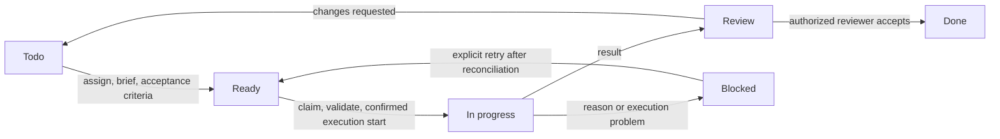

# Optional external dispatch extension

Status: optional design guidance, not shipped functionality. Read with [agent team access](agent-team-access.md). Office Office provides generic MCP access to humans and AI clients, including Hermes, Claude Code, Codex and other compatible runtimes. Basic MCP access does not require dispatch, a watcher, runtime binding or a dedicated dispatcher identity. This document describes an optional external dispatcher/adapter that can connect Office Office assignments to a runtime. Token exchange and effective permissions are covered in [agent team access](agent-team-access.md).

## Workflow

1. An authorized person or lead assigns a task, provides a brief and acceptance criteria, and moves it to **Ready**. This is the explicit request to dispatch.
2. If an external dispatcher is installed, it reads the change, verifies current assignment, permissions, dependencies, brief and acceptance criteria, then atomically claims an eligible execution attempt.
3. The dispatcher requests execution through its configured runtime adapter, carrying the attempt identifier and captured task revision. It records the runtime acknowledgment/reference.
4. Only confirmed execution start moves an agent task to **In progress**. Merely assigning, claiming or requesting a run is not evidence that work started.
5. The specialist posts attributable results with source/report links and moves the work to **Review**, or **Blocked** with a reason. Runtime failure/uncertainty remains visible rather than being described as successful work.
6. A designated, authorized reviewer accepts the result into **Done** or requests changes. Further execution requires an explicit return to **Ready**; a request-for-changes comment alone does not start a run.

Claim/dispatch/run states are separate from the displayed board category. A task may remain Ready with a visible claimed/dispatch-pending attempt while a configured runtime is starting. A stalled or uncertain attempt is shown explicitly and referred to the operator's configured supervision path; it must not quietly return to a dispatchable queue.

Moving to Todo, editing text, reassigning, commenting or repeatedly observing Ready must not implicitly create another attempt. Review initiates a reviewer handoff only when an explicit reviewer and supported routing policy are configured. Review does not default to the author accepting their own work. Configure whether the reviewer is a human or agent and which decisions they may make.

## Responsibilities

| Component | Owns |
| --- | --- |
| Office Office | Assignment, workflow category, brief, acceptance criteria, discussions, attempt records, visible results and approval state |
| External dispatcher/adapter (optional) | Deterministic eligibility checks, authorized atomic claims, dispatch/reconciliation and delivery bookkeeping |
| External runtime (optional) | Execution, runtime conversations, supported cancellation/status operations and runtime references |
| Runtime operator/client configuration | Named-agent behavior, runtime profile selection, ambiguous assignments, stalled work, failed handoffs and escalation |
| Authorized reviewer/owner | Acceptance, changes requested and separately authorized business decisions |

Named-agent behavior and any binding between an Office Office assignment and a runtime profile belong in external client/adapter configuration. Office Office does not require a Hermes-specific profile mapping in its member schema, a special supervisor type, built-in persona or privileged escalation account. A language model is not required to decide routine routing. Neither the dispatcher nor task text may substitute arbitrary shell commands, executable paths or caller-selected runtime profiles for the adapter's configured policy.

Moving a card grants no permission to publish, send messages/invoices, spend money or change security. Those actions retain their separate permissions, approvals and audit requirements. Approval must bind to the actual operation/content and cannot be inferred from Ready, In progress, Review or Done.

## Safeguards for an installed dispatcher

- **Optional runtime binding:** if the adapter maps assignments to runtime profiles, keep that binding in external runtime/adapter configuration and capture its version in an attempt. A lead may assign work but cannot edit adapter configuration unless separately authorized. Profile names embedded in a task or prompt do not override configured policy.
- **Semantic workflow categories:** custom display columns map to Todo/backlog, Ready, In progress, Review, Blocked and Done categories as appropriate. Dispatch keys off the explicit Ready category, never column spelling, comments or generic task-update events.
- **Readiness:** require an eligible active assignee, clear acceptance criteria, a usable brief and satisfied dependencies before dispatch. Recheck at claim time. Missing information remains visible and goes to the lead/supervisor; do not guess an assignee or acceptance criteria. Reject dependency cycles and inaccessible/cross-project references.
- **Atomic claim:** one actor command checks task revision, current Ready intent, eligibility and absence of a conflicting active attempt, then creates/claims the execution attempt and commits its event atomically. Competing workers cannot both win. The client cannot supply a principal that bypasses member/project policy.
- **Execution tracking:** store attempt ID, readiness/dispatch-intent ID, captured task revision, assigned member ID, configured profile/mapping version, claim owner, runtime reference, claim/start/end timestamps, heartbeat/deadline, state, result/report references and error/blocker. Preserve previous attempts rather than overwriting the last run.
- **Heartbeat and timeout:** distinguish claimed, dispatch-pending, running, completed, failed, cancel-requested, cancelled and uncertain/abandoned states. A lost heartbeat is evidence of lost contact, not proof a runtime stopped. Use server time for leases and require the matching attempt/claim to update it.
- **Safe delivery and retry:** polling is at least once. Duplicate changes, claims, dispatch requests, heartbeats and completion callbacks must be idempotent for an attempt. Use a deterministic runtime idempotency/correlation token if the runtime supports it. Persist dispatch intent before crossing the network and reconcile acknowledgments durably afterward.
- **Uncertain start:** if a runtime may have accepted a run but its reply was lost, mark the attempt uncertain and reconcile using supported runtime status/correlation APIs. Do not claim exactly-once external execution merely because the database claim was atomic. If the runtime cannot reconcile/deduplicate, require supervised resolution before any new attempt.
- **Changed tasks and cancellation:** compare every result/status write to its attempt and captured revision. Reassignment, cancellation, profile changes and brief/acceptance/dependency changes invalidate or flag the old attempt. Request stop through a supported runtime mechanism, record the outcome and prevent overlapping replacements. Treat unconfirmed cancellation as uncertain. Historical/stale results may be retained as labeled evidence, but cannot complete or overwrite the new assignment.
- **Scoped access:** a dispatcher has a dedicated identity and narrowly scoped read/claim/reconcile permissions. Runtime credentials and specialist identities are managed by the external client/adapter. The dispatcher must not impersonate specialists, forward its credential as theirs, or hold a shared all-team execution key. Keep credentials out of tasks, domain events and logs.
- **Review:** record a designated eligible reviewer and the reviewed task revision/result/attempt. Revalidate reviewer permission when accepting or requesting changes. A stale review cannot mark newer work Done. Configure reviewer routing explicitly; assignment does not imply approval authority.

Use a transactional outbox or equivalent event-driven delivery mechanism for pending dispatches. Only committed readiness/attempt events may leave the process. An in-process actor serializes local commands, but it cannot make the network call and database commit a single atomic transaction.

## Polling first, webhooks later

Provide a supported incremental changes/pending-assignment API using a durable cursor or monotonic event sequence, not wall-clock timestamps alone. Filter by authorization. Define pagination, stable ordering and cursor expiry/recovery. The dispatcher persists a checkpoint only after observations are processed or durably queued. Starting from a checkpoint after a crash must safely replay pending work.

A polling response is a candidate list, not a grant or claim. Claim against current authoritative state; a changed assignee or lost project grant must fail even if a prior poll returned the task. Recovery must be able to discover Ready work and unresolved attempts without rescanning unauthorized records or silently skipping gaps.

Webhooks may reduce latency later. They need authenticated delivery, deduplication, retries and the same replay/reconciliation path for missed events. Treat a webhook as a notification to read authoritative state, not as permission to start whatever its payload says.

An adapter integration must be checked against the installed runtime's real profile, start, status, idempotency and cancellation interfaces before implementation. Do not invent an execution API or advertise cancellation/exactly-once guarantees that the runtime cannot provide.

## Acceptance tests before calling dispatch functional

In addition to the [identity and permissions matrix](agent-team-access.md#next-deployment-acceptance-matrix), prove:

| Case | Expected behavior |
| --- | --- |
| Ready with valid mapping, dependencies, brief and acceptance criteria | One eligible claim and one recorded execution attempt for the exact member/profile |
| Ready lacks assignee/brief/criteria, has blocked dependencies or lost grants | No dispatch; reason visible to an authorized lead/supervisor |
| Two dispatchers claim the same intent, duplicate poll, or duplicate webhook | One winner; no second attempt/run from duplicate delivery |
| Assign, comment, edit, move to Todo, or observe unchanged Ready repeatedly | No implicit additional execution |
| Claim succeeds but runtime has not confirmed start | Not shown as In progress |
| Runtime accepted start but reply was lost | Uncertain attempt reconciled; no blind duplicate |
| Watcher crashes before/after request or checkpoint commit | Durable recovery neither skips pending work nor creates duplicate attempts |
| Heartbeat stops or a lease expires | Flag uncertain/stalled work; no assumption that the old run stopped |
| Reassign/cancel/edit while an attempt is active | Old attempt flagged/cancellation requested; replacement waits for safe reconciliation |
| Late old completion after reassignment or cancellation | Cannot overwrite current status, assignee, revision or review outcome |
| Specialist submits result | Authorship uses specialist identity; result/run/report references match that attempt |
| Review without designated reviewer, or by unauthorized/stale reviewer | No automatic dispatch/acceptance; current authorization and revision enforced |
| Request changes or retry after a known failure | New attempt only after explicit Ready intent; previous attempt retained |
| Card moves into any category | No publication, external send, spending or security change is implicitly approved |

Until an external dispatcher is installed and these checks pass, assignments remain office records; they do not launch agents. None of these dispatch safeguards is required for basic MCP functional access.
